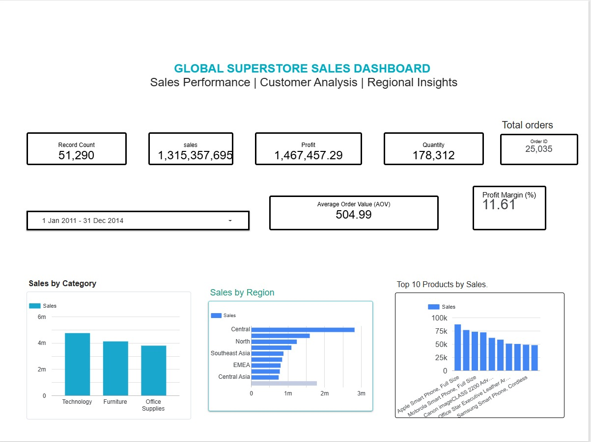
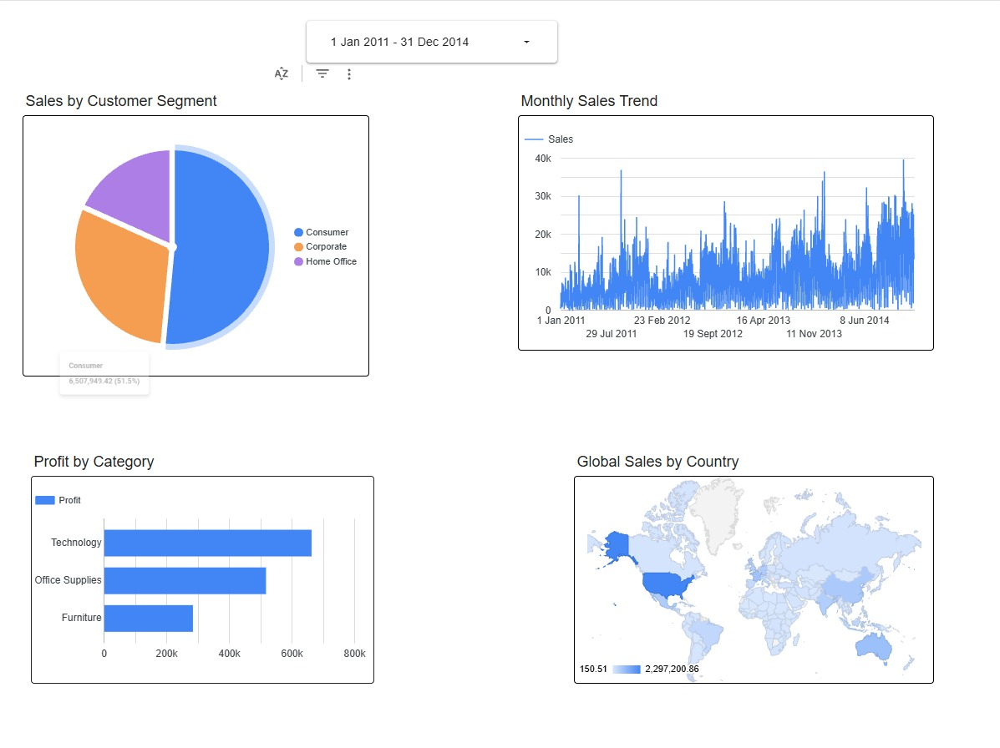
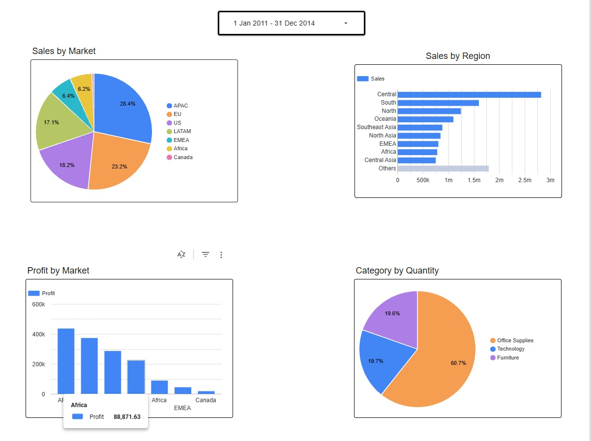

# 📊 Mission 3 – Data Visualization

## 🌍 Global Superstore Sales Dashboard

An interactive business intelligence dashboard developed using **Google Looker Studio** to analyze global sales performance, customer behavior, and regional market insights.

## 🚀 Live Dashboard

🔗 **[View Interactive Dashboard](https://datastudio.google.com/s/qjtzfikRohs)**

## 🛠️ Tools & Technologies

- Google Looker Studio
- Global Superstore Dataset
- Data Visualization
- Business Intelligence
- Data Analytics

## 📸 Dashboard Screenshots

### 1. Sales Overview

**Key Insights:**
- Total Sales, Profit and Quantity
- Total Orders
- Average Order Value (AOV)
- Profit Margin
- Sales by Category
- Sales by Region
- Top 10 Products by Sales

### 2. Customer & Sales Analysis

**Key Insights:**
- Sales by Customer Segment
- Monthly Sales Trend
- Profit by Category
- Global Sales by Country

### 3. Regional & Market Insights

**Key Insights:**
- Sales by Market
- Sales by Region
- Profit by Market
- Category by Quantity

## ✨ Key Features

- Interactive dashboard navigation
- Dynamic date range filtering
- Sales and profit analysis
- Customer segmentation
- Regional performance analysis
- Global sales visualization
- Product performance analysis

## 🎯 Project Objective

The objective of this project is to transform raw sales data into meaningful visual insights. The dashboard helps understand business performance, identify sales trends, analyze customer segments, and evaluate regional profitability.

## 📈 Conclusion

This project demonstrates practical skills in data analytics and visualization using Google Looker Studio. It provides an interactive platform for analyzing sales performance and supporting data-driven business decisions.

## 👨‍💻 Author

**Reyan Reza**

B.Tech CSE – Machine Learning

Gautam Buddha University

GitHub: [ReyanReza3126](https://github.com/ReyanReza3126)
